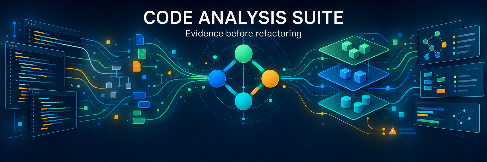

# Code Analysis Suite — see the architecture before you change it.



*Last updated: 2026-10-20*

[](#installation) [](LICENSE)

Code Analysis Suite turns source structure into portable evidence for architecture review and refactoring. Inspect symbols, dependencies, complexity, contracts, duplication and change impact; keep the JSON report and investigate it in the local browser UI, terminal or CLI.

**New here? Start with the [Python beginner tutorial](tutorials/python/beginner/README.md)** or browse [all nine Python, JavaScript and Ruby exercises](tutorials/README.md). Each supplies a working application, saved evidence and an independent investigation before the solutions.

The public beta source is available on GitHub; the current version is `0.2.0b2`. Read the [beta scope and known limitations](docs/beta.md), then install from the repository below. Python 3.12+ is required; the recorded qualification environment uses Python 3.12.13, not a claim that every supported interpreter has been qualified. Repository availability is separate from a tagged release or PyPI publication.

## Quick Start

Install first, then scan your project and open the retained report:

```bash
cd /path/to/project
code-analysis scan .
code-analysis
```

Static analysis parses source without importing or executing the target project. Starting the UI does not start a scan. It offers confirmed collection jobs, with a separate execution acknowledgment for profiling. Use `code-analysis ui --no-collection` for saved-evidence browsing without collection launch capability.

## Installation

Install the repository into an isolated Python environment; these commands do not depend on a PyPI release:

```bash
git clone https://github.com/unixwzrd/code-analytics.git
cd code-analytics
python3.12 -m venv .venv
. .venv/bin/activate
python -m pip install .
code-analysis doctor
```

Choose optional capabilities explicitly from the checkout:

```bash
python -m pip install '.[javascript]'  # JavaScript/JSX parsing
python -m pip install '.[tui]'         # terminal investigation
python -m pip install '.[runtime]'     # explicit coverage/profiling workflows
```

The base installation supports Python analysis and saved-report browsing without Node, Ruby or optional language parsers. JavaScript uses pinned Tree-sitter bindings and grammar, not Node or npm. Ruby analysis uses an existing configured Ruby/Prism installation through an external parser driver; it does not load the target Ruby application. Run `doctor` and `providers` to check availability. Missing parsers remain visible as unavailable evidence.

The separate `semantic` extra requires an explicitly configured existing local model; the tool never downloads a model automatically. See the [CLI reference](docs/cli.md) for optional-provider configuration.

On macOS, `code-analysis` opens or reuses a compatible background UI session and returns your prompt. Closing the browser tab leaves that session running; use **Stop Code Analysis** or `code-analysis ui-stop` to stop it. For terminal-controlled operation without browser launch, use `code-analysis ui --foreground --no-open`. In **Browse code**, use **Connect source folder** if needed, then select a graph node to display its source directly. Nearby README files and their local text links open in a separate read-only project reader. Global **Help** opens the bundled offline guide. See the [UI guide](docs/ui-guide.md) for collection roots, source binding and browser preferences.

## Everyday commands

```bash
code-analysis doctor
code-analysis providers
code-analysis scan .
code-analysis refactor . --json-compact -o refactor.json
code-analysis summary refactor.json
code-analysis diff baseline.json candidate.json --format markdown
code-analysis export refactor.json --projection dependencies --format svg -o dependencies.svg
code-analysis ui refactor.json --source-root . --no-collection
```

The [CLI reference](docs/cli.md), [examples](docs/cli-examples.md), [UI guide](docs/ui-guide.md) and [report and diagram catalog](docs/report-and-diagram-catalog.md) cover focused analysis, queries, projections, comparisons, workspaces and explicit runtime evidence. SVG rendering requires the optional Graphviz executable; a missing renderer is an error, not an empty diagram.

## What a finding means

A finding is evidence for review, not permission to change code. Complexity thresholds identify candidates; orchestration heuristics do not prove an extraction boundary; a resolved import cycle is not automatically a defect. Exact spans and hashes bind observations to the scanned source, not to all possible runtime behavior.

Completeness describes the declared analysis scope. Dynamic dispatch, reflection and unsupported language features remain limitations. An unavailable provider produced no evidence; an empty section is not proof that the corresponding problem is absent. Recommendations still need an ownership, data-flow, dependency, state or compatibility reason beyond line count.

## Meet Code Analysis Suite

One validated report model serves source scans, retained-report queries, comparisons and projections. Investigate the same evidence through a loopback browser UI, an optional indexed terminal UI, self-contained HTML or batch commands. Hash-bound source browsing connects saved observations to matching files; browser editing uses session-only drafts rather than rewriting source.

Start with the [tutorials](tutorials/README.md), then use the [UI guide](docs/ui-guide.md), [CLI reference](docs/cli.md) and [architecture](docs/architecture.md) as needed. The [roadmap](docs/roadmap.md) and [changelog](CHANGELOG.md) distinguish current work from future plans.

## What it analyzes today

| Area | Evidence and review tools |
| --- | --- |
| Structure | Source roots, modules, symbols, spans, local dependencies, import cycles and complexity metrics. |
| Contracts and data flow | Python contracts, dictionary shapes, validation, lifecycle and bounded producer/consumer relationships. |
| Refactoring review | Clone/commonality evidence, state and side effects, responsibility groups and bounded proposals with explicit admission limits. |
| Change and test evidence | Static test impact, explicit Git history, imported coverage and opt-in runtime profiling. |
| Investigation | Saved-report queries, comparisons, tables, graphs, review packets and source-bound browser navigation. |

Python uses the standard-library AST frontend. JavaScript/JSX uses the optional Tree-sitter frontend. Ruby uses an optional external Prism frontend with narrower capabilities. These languages do **not** have feature parity: supported, partial, unsupported and unavailable sections are recorded explicitly. TypeScript/TSX and automatic refactoring are not supported. See the [provider contract](docs/provider-contract.md) and [report catalog](docs/report-and-diagram-catalog.md) for scope and limitations.

## Reports, portability, and proof

`code-analysis-report` is the authoritative persisted JSON schema. Reports retain source-relative paths, SHA-256 source hashes, configuration identity, provider states, completeness, diagnostics, limitations and stable evidence IDs. Identical inputs, configuration, interpreter identity and tool version produce deterministic serialization. The first beta does not imply a historical compatibility guarantee for earlier development reports.

Keep JSON when evidence may need a different presentation later: Markdown, tables, graphs and graphics are projections of validated saved evidence and need no source rescan. Source browsing separately requires matching files and hashes. Portable scan reports omit host and repository-external absolute paths; local `doctor` output intentionally includes installation paths. See the [report schema](docs/report-schema.md) and [provider contract](docs/provider-contract.md).

## Project discovery and configuration

Discovery supports ordinary packages, `src/` layouts, namespace packages and configured logical roots, with exclusions for common VCS, environment, build and cache paths. Configure `[tool.code-analysis]` in `pyproject.toml` or select a TOML file explicitly; configuration identity is bound into reports.

By default, a scan writes owned reports, run records and caches under a self-ignored `.code-analysis/` workspace without changing source. Use `--no-workspace` for read-only targets or `--workspace PATH` for an authorized alternative. See [configuration](docs/cli.md#configuration) and the [source-only example](docs/cli-examples.md#source-only-analysis-without-test-discovery).

## Provider health

`code-analysis doctor` and `code-analysis providers` expose local interpreter and tool availability. Discovery of an executable is not proof that a requested analysis ran successfully. Provider results distinguish successful, partial, unavailable, timed-out, nonzero, malformed and failed execution; missing evidence never becomes successful empty output. See the [provider contract](docs/provider-contract.md).

## CLI and automation

Name a batch command explicitly in automation; bare `code-analysis` opens the UI. Batch commands separate requested output from stderr diagnostics and use host-native errno-based exit statuses, whose numeric values can differ by operating system. See the [CLI reference](docs/cli.md) and [status-preserving shell examples](docs/cli-examples.md).

## Migrating from function-analysis

The package does not import or execute the predecessor script. Compatible flags remain where they map safely to the current report model, but the authoritative JSON report is not byte-compatible with the predecessor's list output. See the [migration guide](docs/migration-from-function-analysis.md) for the exact flag and behavior map.

## Safety and privacy

Static scans do not import target modules, run tests, launch profiling or rewrite source. Optional Ruby parsing invokes a bounded parser process, not the target application. Coverage execution and profiling are separate, explicit workflows requiring execution authorization; managed UI jobs require confirmation. Starting the UI or opening a saved report runs no target workload.

Analysis is local. Optional semantic nomination uses an explicitly configured local model, not an external model service. Reports and exports can still contain source-derived names and details: inspect artifacts before sharing them. Portable path handling is not anonymization. Automatic source modification remains out of scope.

## What's in this repository

- [src/code_analysis/](src/code_analysis/) — analysis, language frontends, report models, providers, CLI and local investigation interfaces.
- [docs/](docs/) — user guides, architecture, schemas, provider boundaries and development guidance.
- [tutorials/](tutorials/README.md) — nine independent exercises and their supplied evidence, available in the GitHub checkout rather than bundled as wheel content.
- [tests/](tests/) — product tests and synthetic fixtures, separate from tutorial behavior checks.

## Contributing

Start with [development guidance](docs/development.md). From an editable development installation, run the narrowest relevant tests first:

```bash
python -m pip install -e '.[dev]'
python -m pytest
```

For UI changes, use `python tools/test_ui.py --smoke`, then the full `python tools/test_ui.py` gate; see [UI testing](docs/ui-testing.md). Automated qualification does not replace human usability acceptance.

Useful contributions include a minimal reproducer, exact tool versions, relevant configuration, expected scope and actual diagnostics. Preserve explicit provider failures and limitations. Reproducible evidence and focused diffs are welcome; invented clean results are not.

## Support this and other projects

If this saved your bacon, you can fuel the caffeine habit and indie development through [Patreon](https://patreon.com/unixwzrd), [Ko-Fi](https://ko-fi.com/unixwzrd) or [Buy Me a Coffee](https://buymeacoffee.com/unixwzrd).

## License

Copyright © 2025-2026 Distributed Thinking Systems LLC — info@unixwzrd.ai

[MIT License](LICENSE)
